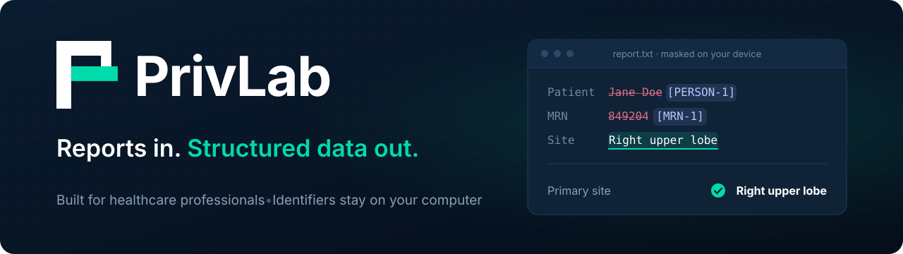
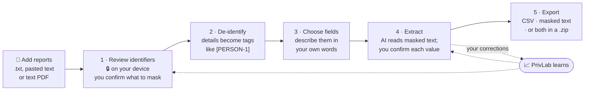
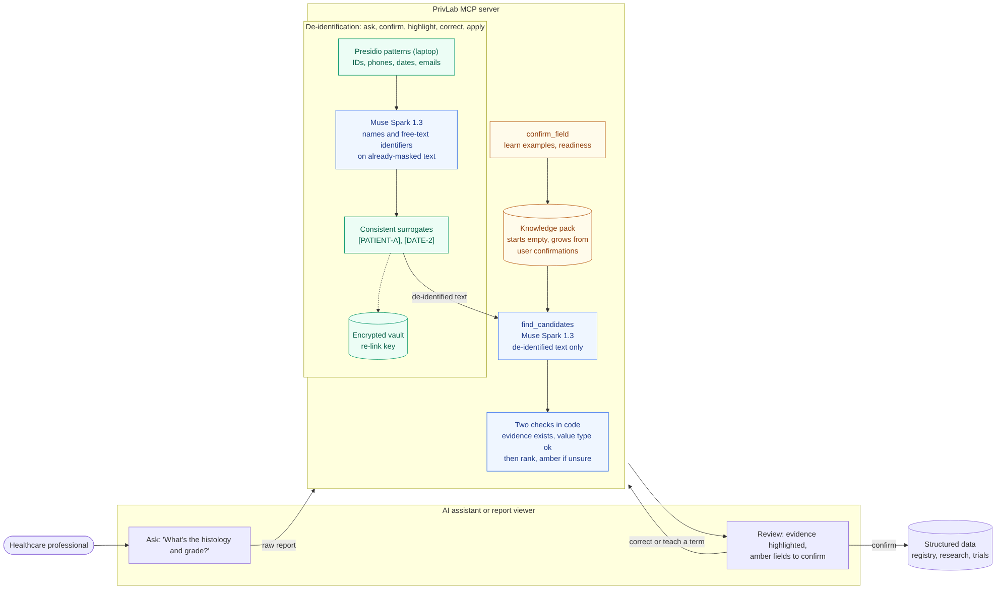

<div align="center">



### Unlock the data in medical reports without the patient ever leaving your device.

✓ **Under a cent per report** (about $7 per 1,000)<br/>
✓ **Full control and visibility** at every step<br/>
✓ **Patient-identifiable information stays safe**<br/>
✓ **De-identify and extract medical data in high volume**

[](#getting-started)

<table>
  <tr>
    <th>▶ Introduction</th>
    <th>▶ Demo</th>
  </tr>
  <tr>
    <td><a href="https://youtu.be/ZSSvqaIar08"></a></td>
    <td><a href="https://youtu.be/8dhbRVAveLg"></a></td>
  </tr>
</table>

Built solo in 9 days for the **Meta Global AI Developer Hackathon** (Track 1, Indie developer) with two Meta models:<br/>
**Muse Spark 1.3** (Meta Model API) and open-weights **Muse Spark Open**.


**[The problem](#the-problem)** · **[The solution](#how-privlab-solves-it)** · **[Results](#results)** · **[How it works](#how-it-works)** ·
**[Getting started](#getting-started)** · **[Models](#models-and-tools)** · **[What's next](#whats-next)**

</div>

---

## Why

In a world where AI is already good enough and fast enough to build, design and execute, what we need more of is
high-quality real-world data. That data is what lets us see patterns, make better decisions, build research databases
for better treatment, and build the next models for the future.

## The problem

In healthcare, about 80% of all data is unstructured: pathology reports, clinical notes, genomic and radiology reports.
These documents hold the information that tells a patient's treatment journey, such as diagnosis, histology, stage and
biomarkers. The volume is huge: a single cancer patient can generate from several to hundreds or even thousands of
documents across their care.

But the same documents hold names, ID numbers, addresses and dates of birth, and patient privacy is the main reason
this information is never shared or analysed. So healthcare professionals end up reviewing documents and entering the
data by hand, which is slow and error-prone. What gets collected is usually a small subset, and dated by the time it
is done.

Similar AI solutions on the market today are black boxes. From working with healthcare AI, I see three more gaps in
building a useful solution for data annotation and extraction.

- **The prompt gap:** To extract or annotate values from medical documents, a developer has to collect domain
  knowledge from doctors and turn it into AI prompts. But medical context is complex and varies from one expert to the next.
- **The validation gap:** The AI output has to be validated by human annotators, and their reading of a document often
  differs from each other, from the doctor and from the developer. Validation metrics fluctuate, and most of the
  "errors" are really communication gaps.
- **The transparency and trust gap:** The end users, the doctors and registrars, have no visibility over the
  end-to-end process and no way to change anything. They do not trust the product, and adoption is poor.

I built PrivLab to unlock this data for registries, research, data sharing and AI training, starting with pathology
reports.

## How PrivLab solves it

| Problem | How PrivLab solves it |
|---|---|
| **Privacy** | Personal details are found and masked on your device before any AI sees the report, and you confirm the masking yourself. An open-weights model double-checks the masked text, and it can be hosted in-house. The privacy guard is built into the code: only masked text can ever reach an AI. |
| **Manual data entry** | Muse Spark 1.3 reads the masked report and highlights each value with the words it came from. You confirm instead of retype, one report at a time in the browser or a whole folder at once through Muse Code. |
| **The prompt gap** | There is no developer and no prompt to hand over. The doctor or registrar describes a field in their own words, and Muse Spark 1.3 turns it into a precise medical definition they approve. The definition is the spec, written by the person who knows what it means. |
| **The validation gap** | The same person who defined the field validates its values, so there is no annotator reading the document differently. Every check is scored, about one in ten is a blind check, and a field is Proven accurate only when the user's own checks show it, with 95% confidence. |
| **The transparency and trust gap** | Every value shows its source in the report, every uncertain value is flagged instead of guessed, every correction is learned and listed where the user can remove it, and the accuracy of every field is shown on its card. The user sees the whole process and can change any part of it. |

## What you get

- **Safe:** 100% of 604 personal details in the held-out test reports were hidden on the device before any AI call.
- **Fast:** Minutes instead of hours, and whole folders in bulk through Muse Code.
- **Cost-effective:** Under a cent per report. Measured from PrivLab's own usage log on the sample reports: the safety
  check about $0.002 (Muse Spark Open), extracting all fields about $0.004 (Muse Spark 1.3), so 1,000 reports cost
  about $7. De-identification alone is free, and cached re-reads cost nothing.
- **Trustworthy:** You never take PrivLab's word for it. Every value is highlighted in the report so you can see where
  it came from, and a field earns the "Proven accurate" label only after you have checked enough of its values yourself.
- **Personalisation:** Remembers and learns every change and correction you make, in both de-identification and
  extraction, on your device.
- **Easy to adopt:** Use it in the browser, with clear step-by-step interaction, or from your AI assistant through MCP.
  Process a single report or a whole batch. Share the results the way you need: structured data as a CSV, masked
  documents as text, or the whole package with both plus a data dictionary.

## Results

Measured on synthetic data, on the device, **before any AI call**. Scored the way clinical de-identification benchmarks
are: each personal detail is fully hidden, partly hidden or missed, and every word is checked (precision: hidden words
that really were personal; recall: personal words that were hidden).

| Test set | Personal details | Fully hidden | Partly / missed | Precision | Recall | F1 |
|---|---:|---:|:---:|---:|---:|---:|
| Pathology reports (dev) | 253 | **100%** | 0 / 0 | 100% | 100% | **1.00** |
| Pathology reports (extra) | 1,623 | **100%** | 0 / 0 | 100% | 100% | **1.00** |
| Tricky formats (red-team) | 30 | **100%** | 0 / 0 | 98.8% | 100% | **0.99** |
| Hand-written hard cases: no cues, statements, bank details, addresses | 130 | **98.5%** | 1 / 1 | 98.2% | 97.6% | **0.98** |
| Uncued names benchmark (frozen, never tuned on) | 56 | **94.6%** | 0 / 3 | 96.3% | 95.1% | **0.96** |
| **Held-out test reports (scored after the freeze)** | 604 | **100%** | 0 / 0 | 95.9% | 100% | **0.98** |

**With the AI safety check** (Muse Spark Open reads the masked text once, after you confirm), the full system catches
**100% of the uncued names** (56 of 56; the 3 that reached the check unmasked were caught) and **98.5% of the hard
cases**. The two left are a vague contact ("line 3") and a road described by landmarks.

How to read this honestly: the hard cases helped shape the rules, so that is a development score. The uncued benchmark
was frozen before any rule was tuned. The 50 held-out test reports were scored after the rules were frozen, and once
more after one fix found in real use (the local name model had been hiding clinical phrases such as "Lymph Nodes
Stations"); both times all 604 personal details were hidden on the device and none reached the AI. The 41 words hidden
that were not personal (28 of them shown as "possible name" for you to untick) give the 95.9% precision.

For context, a John Snow Labs benchmark found that two open-source AI-only tools missed more than half of the personal
details in clinical text ([article](https://medium.com/john-snow-labs/how-good-are-open-source-llm-based-de-identification-tools-in-a-medical-context-6600ddac6a0f)).
That is why PrivLab does not rely on an AI alone. Different data, so the numbers are not directly comparable.

> [!IMPORTANT]
> **What PrivLab keeps by default.** Clinical dates and ages stay visible; only the date of birth is hidden. Under HIPAA
> Safe Harbor every date tied to a person except the year, and any age over 89, counts as an identifier; tick "Other
> dates" in the privacy choices to hide all dates. Date shifting and "90+" ages are on the roadmap.

> [!NOTE]
> All data in this repository is synthetic: public pathology text (TCGA) with invented personal details.

## How it works



1. **Read on your device:** Add reports as text files, pasted text or PDFs. PrivLab reads them on your own computer and
   turns a PDF into text locally, so nothing is uploaded to the cloud.
2. **De-identify on your device:** PrivLab finds the personal details in the locally read report, using pattern
   recognisers and a local name model, and masks each one as a tag such as `[PERSON-1]`, so `Sarah Jenkins (MRN 849204)`
   reads `[PERSON-1] (MRN [MRN-1])`. You review and validate the masked text before anything is sent.
3. **Privacy guardrail:** The masked text is scanned once by open-weights Muse Spark Open, which flags any identifier
   the rules missed.
4. **Smart medical field definition:** You share brief information about a field: its name, a short description and an
   example. The AI assistant, powered by Muse Spark 1.3, proposes an accurate and precise medical definition and a
   preview of the annotation on your report, so you can check it before you proceed to extraction.
5. **Annotate and validate:** You are the one who validates. Muse Spark 1.3 annotates and highlights each value in the
   masked report; if it is unsure, PrivLab flags the value for your review. The more you check, the more accurate
   PrivLab becomes. Each field's card shows its accuracy so far and how far it is from Proven accurate (with 95%
   confidence, at most 5% of its values wrong). About one value in ten is a blind check, where PrivLab hides its answer
   until you give yours.
6. **Learn and personalise:** PrivLab learns from you at both stages. In de-identification, an identifier such as a
   name you hide once is remembered and caught on your device the next time, without any AI call. In extraction, every
   value you confirm or correct becomes an example that steers the next reports, and a correction can be applied to
   the other reports in the batch and kept for the future. Over time PrivLab works the way you do.
7. **Flexible export:** Export the extracted structured data as a CSV, or all the locally masked documents as text, or
   the full package: the structured data, the masked texts and a data dictionary with the definition of every field
   you extracted, in one zip. Before each download, PrivLab tells you what the file holds and what was left out.



## Three ways to use PrivLab

1. **In the browser:** PrivLab runs fully in your browser on your own computer. You control each step, review every
   document and confirm every value. Best for checking a few reports carefully.
2. **From your AI assistant:** PrivLab connects to assistants such as Muse Code through MCP, for bulk processing of
   high volumes of documents: point it at a folder, approve the masking once, and only the uncertain values come back
   to you. Each report still opens in the browser whenever you want to look.
3. **Deployed in-house:** Run PrivLab locally with open-weights Muse Spark Open as the base model, hosted on your own
   servers, so nothing leaves the building. Use it for de-identification only, or end to end for de-identification and
   extraction.

Same reports, same fields, same learning either way.

## Getting started

You need Python 3.11 or newer. Windows is the tested platform; macOS and Linux use the same steps.

**1. Install**

```powershell
# Windows
git clone https://github.com/megan-chu/PrivLab.git
cd PrivLab
python -m venv .venv
.venv\Scripts\python -m pip install -r requirements.txt
copy .env.example .env
```

```bash
# macOS / Linux
git clone https://github.com/megan-chu/PrivLab.git
cd PrivLab
python3 -m venv .venv
.venv/bin/python -m pip install -r requirements.txt
cp .env.example .env
```

**2. Add your keys to `.env`.** Two local secrets (one command each, shown in `.env.example`) and two API keys. Each
AI key turns on one more step; anything missing is skipped or marked amber, never a crash.

| Key in `.env` | Needed for | Without it | How to get it |
|---|---|---|---|
| `PRIVLAB_SEAL_KEY`, `PRIVLAB_VAULT_KEY` | Sealing masked text; encrypting the vault and cache | PrivLab generates them on first start and saves them to `.env` | One `python -c` command each, in `.env.example`; they never leave your computer |
| `BASETEN_API_KEY` | Second name check on masked text (Muse Spark Open) | Amber "review manually"; nothing is sent | Baseten (the hackathon key works with `meta-models/muse-spark-open-1026`) |
| `META_API_KEY` | Field definitions and extraction (Muse Spark 1.3) | De-identification works; extraction says the key is missing | Meta Model API |
| `BASETEN_DECISION_API_KEY` | *Optional.* Second opinion on values and on undecided name words | Skipped; you are asked as usual | A separate Baseten API key |

> [!TIP]
> With no API key at all you still get the whole de-identification on your computer, all tests, and the scorers.

**3. Start PrivLab.** On Windows, double-click **`PrivLab.cmd`**. On any system:
`.venv\Scripts\python -m viewer.server --open` (Windows) or `.venv/bin/python -m viewer.server --open` (macOS/Linux).
It opens http://127.0.0.1:8765. Using it from an AI assistant instead? Skip this: PrivLab opens its page by itself when
the assistant connects.

## Use it in your browser

1. **Add a report.** Drop a `.txt` or text PDF on the page, choose **+ Add → Choose files…**, paste text with Ctrl+V,
   or click a sample (**Breast**, **Lung**, **Colon**, or **All 3** for a batch).
2. **Choose your task** at the top: *De-identify only*, or *De-identify + extract*.
3. **Review identifiers.** Every personal detail found is highlighted; words marked *possible name* are ticked to be
   safe. Click a highlight to keep it visible, or select any missed text to hide it. Then click
   **Confirm N identifiers for masking**. Nothing has been sent before this click.
4. **De-identify.** The details become tags and the masked text gets one AI safety check. Click
   **Confirm and choose fields** (or download the masked text and stop here).
5. **Choose fields.** Tick the fields you want, or **+ Add a field**: describe it in your own words, give an example
   value, and approve the definition PrivLab drafts.
6. **Extract.** Each value is highlighted with its quote. Confirm it, select the right text to correct it, or mark it
   *not stated*. A correction can be applied to the other reports and kept for the future. Then
   **Finish and export this report**.
7. **Export.** **Extracted data (.csv)**, **Masked reports (.zip)** or **Everything (.zip)**. Before each download,
   PrivLab says what the file holds and what was left out.

**A batch:** add all reports, review each one's identifiers, choose the fields once, then **Extract all**. Verified
values are saved; anything that needs a person is listed for you.
**See what it learned:** **Fields → Learned** lists everything PrivLab learned from you; remove anything you like.

## Use it from your AI assistant (MCP)

PrivLab is a **local MCP server**: your assistant starts it on your own computer. No web address, nothing to sign in
to, and your reports never leave your computer.

1. **Install PrivLab** (above).
2. **Tell your assistant how to start it.** Muse Code: open `C:\Users\<you>\.config\muse\settings.json` and add
   (with your own paths):
   ```json
   "mcp_servers": {
     "privlab": {
       "command": "C:/path/to/PrivLab/.venv/Scripts/python.exe",
       "args": ["C:/path/to/PrivLab/mcp_server/server.py"]
     }
   }
   ```
   Claude Desktop: Settings → Developer → **Edit Config**, same block under `"mcpServers"`.
3. **Restart the assistant** (Muse Code: `/exit`, then `muse` from the PrivLab folder).
4. **Check it is connected.** Ask *"What PrivLab tools do you have?"* You should see 6: `privlab_deidentify`,
   `privlab_review`, `privlab_fields`, `privlab_extract`, `privlab_wait`, `privlab_export`.
5. **Give it a report.** *"Fill my fields for C:/reports/case1.txt with PrivLab."* PrivLab finds the personal details on
   your computer and opens the report in your browser, highlighted. The chat shows only tags.
6. **Answer its questions**, e.g. *"Hide them all"*. Only then is the masked text sent, once, for the safety check.
7. **Choose fields and extract.** The assistant asks which fields you want (define a new one if you like), then
   *"Extract the values"*: each comes with its quote. *"All correct"*, or correct one (*"…except the margin: 6 mm"*).
8. **Export.** *"Export the CSV to my Desktop."*

**A whole folder:** teach your fields on 1–3 reports first, then *"Process every report in C:/reports/batch1"*. PrivLab
masks every report on your computer, you approve once, verified values are saved by themselves once a field is Proven
accurate, the uncertain ones come back to you, and it asks where to save.

> [!TIP]
> **Under the hood:** six outcome-based tools with flat arguments and "Use when…" instructions, five ready-made prompts,
> paged results, and `privlab_wait` so the chat carries on by itself once you finish a report in the browser.

## Models and tools

| Model or tool | Where it runs | Job in PrivLab |
|---|---|---|
| Presidio-style patterns, checksums and a spaCy name model | On the device | Finding and masking personal details; the leftover scan after masking |
| **Muse Spark Open** | Open weights, hosted on Baseten | The security guardrail on masked text. Because the weights are open, a hospital can host it in-house and nothing leaves the building. Muse Spark 1.3 is its qualified backup |
| **Muse Spark 1.3** | Meta Model API | Field definitions, annotation and extraction: one checked JSON call per report, steered by examples learned from your corrections |
| **Elephant-1** | Baseten decision model | A second opinion on whether an annotated value needs the user's review; answers yes or no in under a second |
| **Muse Code** | Command line (CLI) | Coding partner and tester for the nine-day build (it even ran usability tests on the browser UI); also a PrivLab user through MCP |

A model is used only after passing a privacy qualification test on synthetic reports (`profiles/model_qualification.json`).
Every call is one per report per step, cached, and logged with its tokens and cost.

> [!NOTE]
> **Why Meta's models matter here.** Muse Spark Open has open weights, so a hospital can run the privacy check on its own
> servers; that is the only way "nothing leaves the building" can be a real promise, and extraction can move in-house the
> same way later. Muse Spark Open and Muse Spark 1.3 are one family taking the same structured call, and both passed the
> same privacy test, so each can stand in for the other. Muse Spark 1.3 understands medical data well: it turns a field
> described in everyday words into a full medical definition, and returns a consistent JSON structure every time, so every
> value comes with the exact words it was taken from and code can check it. Muse Code lets PrivLab live inside an assistant
> people already use.

## Engineering

- **A privacy guard in the code, not in good intentions.** Only one module (`common/spark.py`) can contact an AI, and
  it accepts only masked-text objects built by the de-identification code, never a string. Every message is scanned
  again before sending. MCP tools take a file path or a report id, never report text.
- **Model proposes, code decides.** Every answer is structured JSON; offsets, masking, green/amber status and pass/fail
  are computed in code. A quote that is not in the report is rejected, not shown.
- **Verified values.** Each value must match its quote and the quote must appear in the report; numbers are parsed with
  their written unit (2.7 cm is saved as 27 mm, not 2.7 mm).
- **Proof, not vibes.** A field is Ready only when an exact 95% confidence bound (Clopper-Pearson) on its error rate is
  at or below 5%; blind checks are chosen by hash so they cannot be gamed; a re-check of a report PrivLab learned from
  never counts.
- **Learning without fine-tuning.** Confirmations and corrections become examples and rules in a local pack that steer
  the next extraction call; nothing about you is sent to train anything.
- **Crash-free and resumable.** Every external call is wrapped: an error, timeout or bad JSON becomes an amber "review
  manually", never a crash and never a raw-text fallback. Run state is saved per report so any run can be resumed.
- **Encrypted vault and cache.** The link from tags back to originals is encrypted on the device.
- **279 automated tests**, none of which call an AI (a fake model is used).

## Running the tests

```powershell
# Windows (macOS/Linux: .venv/bin/python). No API key needed.
.venv\Scripts\python -m pytest -q                        # 279 tests, no AI calls (a fake model is used)
.venv\Scripts\python -m eval.score_deid --split hard     # de-identification score on the hard cases
```

## What's next

- Run the safety check fully in-house, so nothing leaves the organisation during de-identification.
- Date shifting and "90+" ages, for HIPAA Safe Harbor.
- Realistic stand-in names instead of tags, so a missed name hides among invented ones.
- A score on a public clinical benchmark (e.g. the n2c2 2014 de-identification set).
- Read scanned documents (OCR) on the device.
- More languages and name forms, including Chinese, Japanese and Korean characters.
